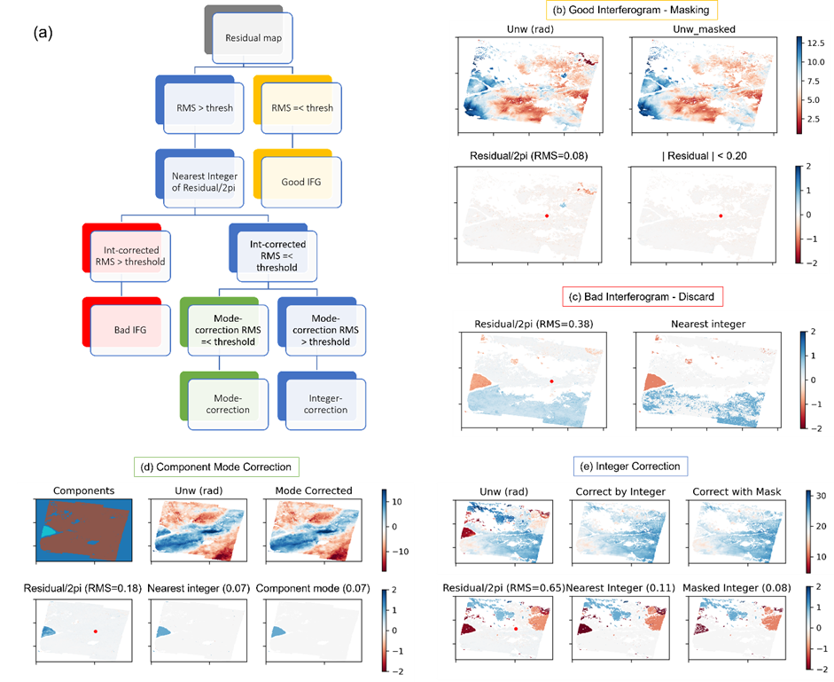
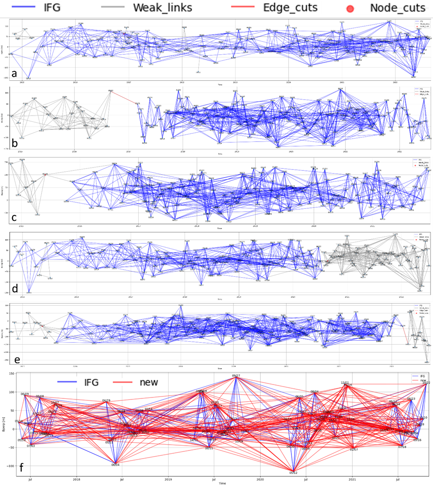
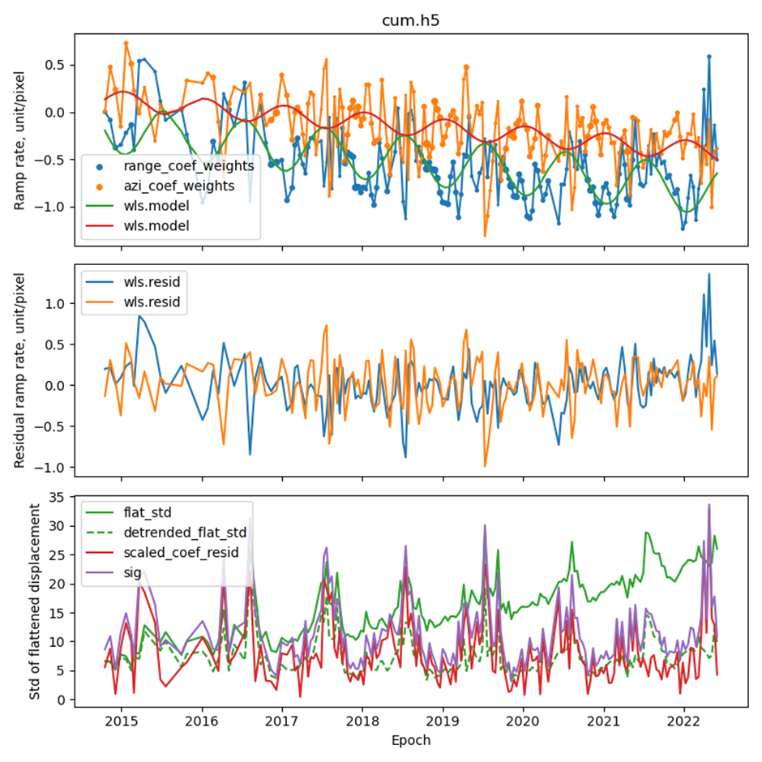

### What's new:

1. **bin/LiCSBAS11_check_unw.py:** Added the -s flag which checks for coresgistration errors that manifest as a strong azimuthal ramp in the unwrapped interferogram. This flat checks the linear fit to pixels extracted from the central column of the frame, and uses hard-coded R^2 and slope as threshold to weed out such problematic interferograms. 
   
   
   

2. **bin/LiCSBAS120_choose_reference.py:** A script that automatically select a reference window based on coherence, pixel coverage, connected components and terrain ruggedness. 

3. **bin/LiCSBAS131_residual_threshold.py:** A script that plots a histogram of RMS residuals per IFG for the network and to automatically suggest threshold for discarding IFGs from the network.

4. **bin/LiCSBAS132_3D_correction.py:** A script that performs automatic correction of unwrapping mistake based on residuals. 
   - **--mask_by_residual**: Discard pixels with |residuals| greater than a threshold (mean, median, mode from 131, or a user-defined threshold provided by -s). As this approach retains all inteferogram, a network plot with interferogram segments colour-coded by percentage of remaining pixels is generated.
   - **--correction_by_integer**: If a pixel residual is within 20% of an integer multiple of 2pi, the pixel is corrected by the integer multiple of 2pi. Otherwise, the pixel is discarded. 
   - **--correction_by_mode**: It takes in the connected components raster, a bi-product of the SNAPHU unwrapping algorithm. For each connected component, it calculates the mode residual of all the pixels in that component, and correct all pixels in that component by the nearest integer of 2pi as suggested by the mode. This works well when a frame contains separate districts separated by, say, water bodies. 
   - **--best_network**: It prioritises the integrity of a well-connected network. It starts with the given threshold (provided by -g and/or -s), and iteratively increases the threshold by steps of 0.01 until there would be no gap in the final network where all interferograms have RMS residuals smaller than the final threshold. A final network is plotted. 
   - **Default**: It follows the decision tree in panel (a), and separates all interferograms in a frame into bad, mode-corrected and integer-corrected. As mode correction is more restrictive than integer correction, mode correction tends to result in a higher remaining residual after correction than integer correction, hence we define:
       - **bad-interferograms**: RMS residual > threshold even after integer correction, they are discarded.
       - **mode-corrected**: RMS residual < threshold after mode correction
       - **integer-corrected**: RMS residual > threshold after mode correction, but < threshold after integer correction
  All correction steps are plotted as pngs for users to check visually. 

5.**bin/LiCSBAS_plot_network.py:** Added the following flags, employing graph theory to tidy up the network. Weak connections are interferograms with a loose end in the network - they will always have zero residual from time series inversion, hence can be iteratively removed using the -s flag. Edge cuts represent solo interferograms linking separate networks on each end. They are also not in any loops hence will always have zero residual from time series inversion. Node cuts are nodes linking two separate networks; they do not cause problems with residuals, hence can be retained. To help strategize visual checking of correction results, it is possible to use the -m flag to separate interferograms by named months. Strict mode (default) requires both epochs of an interferogram to be in the named months to fall into the group. --not-strict flag allows interferograms with either epoch in the named months to fall into the group.

    -s Separate strongly connected component from weak connections
    -m Allowed months (eg. 3.4.5.12, months separated by period, order doesn't matter)
    -t lower bound of temporal baseline
    -e keep edge cuts (option when -s is used)
    -n keep node cuts (option when -s is used)
     -l label for "red lines" when -r is used
    --skip_node_cuts do not check for node cuts (option when -s is used)
    --not_strict keep ifg as long as one epoch is in an allowed month (option when -m is used)
    -T to add a title to the plot

6.**bin/LiCSBAS_densify_ifgs.py:** A script that generates a IFG pair list that could densify a network based on provided IFG list or lists of primiary and secondary epochs, with constraints of temporal baseline ranges and total number of additional IFGs needed (panel f). 

    -p PRIMARY_EPOCH_LIST
                        input text file containing a list of epochs to serve as primary epochs (default: None)
    -s SECONDARY_EPOCH_LIST
                        input text file containing a list of epochs to serve as secondary epochs (default: None)
    -e EXISTING_IFG_LIST  input text file containing a list of epochs, used to avoid generating existing ifgs in the output list, or used to provide primary and secondary epochs when -p and -s are not used. (default: None)
    -o OUTPUT_IFG_LIST    output text file containing a list of epochs (default: dense_list.txt)
    -l MINIMUM_TEMPORAL_BASELINE
                        minimum temporal baseline in days (default: 13)
    -u MAXIMUM_TEMPORAL_BASELINE
                        maximum temporal baseline in days (default: 400)
    -m MAXIMUM_NUMBER     evenly sample new list to below this total number (default: 500)

7.**bin/LiCSBAS_cum2vel_weighted.py:** Compared to the LiCSBAS_cum2vel.py, this scripts adds the options to derive seasonal amplitude and peak time maps, and to weight the time series decomposition. The weights combine both long-wavelength and short-wavelength variances in a cumulative displacement time series. The long-wavelength planar ramp coefficients that make part of the weighting have seasonal signals removed. The short-wavelength std part of the weighting have a linear trend removed. The weighting makes the final veloctiies more robust, less influenced by planar ramps in epochs espeically at the beginning or the end of the times series. The vstd derived with weighting also has more reliable spatial structure, with the reference effect easier to correct. 

    -p                    model planar ramp and use std of flattened time series to weight vel inversion (default: False)
    -s                    model seasonal trend (default: False)
    -l                    model linear trend (default: False)
    --heading {-10,-170,0}
                          heading azimuth, -10 for asc, -170 for dsc, 0 if in radar coordinates, required if using deramp (default: 0)
    --plot_cum            plot 3D time series (default: False)
    --plot_vel            plot vel components and uncertainties (default: False)
    --de_season           save the time series without the seasonal component, requires -s (default: False)

## Iterative correction procedure:
In order to maximise the opportunity for each interferogram to be corrected/masked hence retained in the network (useful in challenging study regions like the Tian Shan), we skip LiCSBAS12_loop_closure.py, which discard entire interferograms, to try correcting what we can using LiCSBAS132_3D_correction.py. We use LiCSBAS130_sb_inv.py instead of LiCSBAS13_sb_inv.py mainly to save time. LiCSBAS130_sb_inv.py skips the calculation of masking statistics that is in the LiCSBAS13_sb_inv.py, because we only want to calculate the masking statistics after the final iterations. LiCSBAS_plot_network.py refines the network after discarding some bad interferograms. Correcting the unwrapping mistakes and discarding bad interferograms will change the residuals of the time series inversion for the next run. We can loop through steps 130-132 and plot_network for as many times as needed until we are happy with the final network, interferograms, and residuals. Then LiCSBAS133_write_h5.py calculates the final masking statistics and writes the full cum.h5.

Note: new flag --nullify is now available in latest LiCSBAS12_loop_closure.py to nullify bad pixels but still not correct bad pixels.

    LiCSBAS11_check_unw.py -d GEOCml10GACOS -t TS_GEOCml10GACOS -u 0.6 -s
    LiCSBAS120_choose_reference.py -d GEOCml10GACOS -t TS_GEOCml10GACOS
    LiCSBAS130_sb_inv.py -l TS_GEOCml10GACOS/info/120strong_connected_links.txt --suffix 1 --inv_alg WLS --keep_incfile --nopngs
    LiCSBAS131_residual_threshold.py --suffix 1
    LiCSBAS132_3D_correction.py -o GEOCml10GACOS2 --suffix 1 -s 0.15
    LiCSBAS_plot_network.py -i TS_GEOCml10GACOS/info/132good_ifg_uncorrected1_0.15_0.15.txt -b GEOCml10GACOS/baselines -s -m 3.4.5.6.7.8.9.10 -t 6
    ### visual checking and making a final_list.txt containing a list of yyyymmdd_yyyymmdd of good interferograms 
    LiCSBAS130_sb_inv.py --inv_alg WLS --keep_incfile --nopngs -l final_list.txt --suffix 2 
    LiCSBAS131_residual_threshold.py --suffix 2
    ### decide if we need another iteration to correct interferograms, refine network and perform time series inversion. Once satisfied:
    LiCSBAS133_write_h5.py -l final_list.txt --suffix 2
    LiCSBAS14_vel_std.py -t TS_GEOCml10GACOS
    LiCSBAS15_mask_ts.py -t TS_GEOCml10GACOS -c 0.05 -u 1.5 -v 2 -T 3 -g 5 -s 5 -i 200 -l 5 -r 1.5

## Citation for the scripts and approach above:
Ou, Q., Elliott, J., Maghsoudi, Y., Rollins, C., Lazecky, M., & Wright, T. (2025). Extension of Tian Shan along a nascent shear zone. https://doi.org/10.21203/RS.3.RS-7529996/V1

------

(note: a testing binder ipynb tutorial is available [**here**](https://mybinder.org/v2/gh/comet-licsar/LiCSBAS/HEAD?labpath=licsbas_tutorial.ipynb))  

# LiCSBAS

LiCSBAS is an open-source package in Python and bash to carry out InSAR time series analysis using LiCSAR products (i.e., unwrapped interferograms and coherence) which are freely available on the [COMET-LiCS web portal](https://comet.nerc.ac.uk/COMET-LiCS-portal/).

Users can easily derive the time series and velocity of the displacement if sufficient LiCSAR products are available in the area of interest. LiCSBAS also contains visualization tools to interactively display the time series of displacement to help investigation and interpretation of the results.

   

THIS IS RESEARCH CODE PROVIDED TO YOU "AS IS" WITH NO WARRANTIES OF CORRECTNESS. USE AT YOUR OWN RISK.

## Documentation and Bug Reports

See the [**wiki**](https://github.com/yumorishita/LiCSBAS/wiki) pages and [quick start](https://github.com/yumorishita/LiCSBAS/wiki/2_0_workflow#quick-start).

If you have found an issue or bug, please report it on the [issues page](https://github.com/comet-licsar/LiCSBAS/issues), while you may also check for answers in the original [Yu Morishita implementation issues page](https://github.com/yumorishita/LiCSBAS/issues).

## Sample Products and Tutorial

- Frame ID: 124D_04854_171313 (Italy)
- Time: 2016/09/09-2018/05/08 (~1.7 years, 67 epochs, ~217 interferograms)
- Clipped around Campi Flegrei (14.03/14.22/40.78/40.90)

- Tutorial: [LiCSBAS_sample_CF.pdf](https://raw.githubusercontent.com/wiki/yumorishita/LiCSBAS/documents/LiCSBAS_sample_CF.pdf) (1.3MB)

- Sample batch script: [batch_LiCSBAS_sample_CF.sh](https://raw.githubusercontent.com/wiki/yumorishita/LiCSBAS/documents/batch_LiCSBAS_sample_CF.sh) (2021/3/11 updated)
- Sample results: [LiCSBAS_sample_CF.tar.gz](https://raw.githubusercontent.com/wiki/yumorishita/LiCSBAS/sample/LiCSBAS_sample_CF.tar.gz) (63MB) (2021/3/11 updated)

## Citations

Morishita, Y.; Lazecky, M.; Wright, T.J.; Weiss, J.R.; Elliott, J.R.; Hooper, A. LiCSBAS: An Open-Source InSAR Time Series Analysis Package Integrated with the LiCSAR Automated Sentinel-1 InSAR Processor. *Remote Sens.* **2020**, *12*, 424, https://doi.org/10.3390/RS12030424.

Morishita, Y.: Nationwide urban ground deformation monitoring in Japan using Sentinel-1 LiCSAR products and LiCSBAS. *Prog. Earth Planet. Sci.* **2021**, *8*, 6,  https://doi.org/10.1186/s40645-020-00402-7.

Lazecký, M.; Spaans, K.; González, P.J.; Maghsoudi, Y.; Morishita, Y.; Albino, F.; Elliott, J.; Greenall, N.; Hatton, E.; Hooper, A.; Juncu, D.; McDougall, A.; Walters, R.J.; Watson, C.S.; Weiss, J.R.; Wright, T.J. LiCSAR: An Automatic InSAR Tool for Measuring and Monitoring Tectonic and Volcanic Activity. *Remote Sens.* **2020**, *12*, 2430, https://doi.org/10.3390/rs12152430.

## Acknowledgements

This work has been accomplished during Y. Morishita’s visit at University of Leeds, funded by JSPS Overseas Research Fellowship. Further updates of the software are organised by the COMET LiCSAR team.

COMET is the UK Natural Environment Research Council's Centre for the Observation and Modelling of Earthquakes, Volcanoes and Tectonics. LiCSAR is developed as part of the NERC large grant, "Looking inside the continents from Space" (NE/K010867/1). LiCSAR contains modified Copernicus Sentinel data [2014-] analysed by the COMET. LiCSAR uses [JASMIN](http://jasmin.ac.uk), the UK’s collaborative data analysis environment.

The [Scientific Colour Maps](http://www.fabiocrameri.ch/colourmaps.php) ([Crameri, 2018](https://doi.org/10.5194/gmd-11-2541-2018)) is used in LiCSBAS.

*Yu Morishita (PhD)\
JSPS Overseas Research Fellow (June 2018-March 2020)\
Visiting Researcher, COMET, School of Earth and Environment, University of Leeds (June 2018-March 2020)\
Chief Researcher, Geography and Crustal Dynamics Research Center, Geospatial Information Authority of Japan (GSI)*

      
